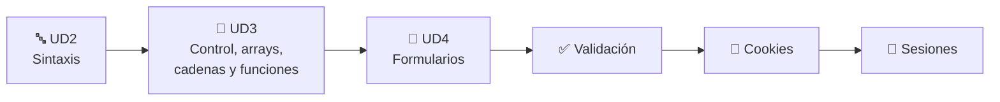

<div align="center">

# 🐘 UDAW · DWES

### Desarrollo Web en Entorno Servidor · MP0613

Mis ejercicios, tareas evaluables y proyectos de PHP del ciclo superior de<br/>
**Desarrollo de Aplicaciones Web** a distancia (Xunta de Galicia, curso 2026-2027).

<br/>


<br/>


<br/>

[**Tareas**](#-índice-de-tareas) &nbsp;·&nbsp; [**Ramas**](#-ramas) &nbsp;·&nbsp; [**Estructura**](#-estructura) &nbsp;·&nbsp; [**Arrancarlo**](#-puesta-en-marcha) &nbsp;·&nbsp; [**Convenciones**](#-convenciones)

</div>

---

> [!TIP]
> Estás en la rama **`Pablo`**, la de trabajo: aquí están los enunciados, mis plantillas de cada ejercicio y el dashboard con el que llevo la cuenta de lo que me queda.

<!-- PROGRESO:INICIO -->
**Progreso:** `███░░░░░░░░░░░░░░░░░` **14 %** · 8/57 ejercicios · 4 h · [ver detalle](PROGRESO.md)
<!-- PROGRESO:FIN -->

## 🧭 Cómo trabajo en esta rama

**1. Abro el dashboard.** Con Apache encendido, entro en `http://localhost/UDAW-DWES/dashboard.php` y le doy a **▶ Continuar**, que me lleva directo al siguiente ejercicio pendiente.

**2. Relleno la plantilla.** Cada ejercicio tiene su fichero (`ejN-*.php` o `*.md`) con el objetivo, alguna pista, la trampa que suele caer en el examen y los pasos marcados como `// TODO`. La solución no está; esa me toca a mí.

**3. Marco el estado en la cabecera.** Cada fichero lleva esto arriba:

```php
 *  @estado  en-progreso    ← pendiente | en-progreso | completado
 *  @horas   1.5
```

Lo cambio a mano o desde el propio dashboard, que tiene un selector de estado y botones **+½ h** / **−** para apuntar las horas.

**4. Lo demás va solo.** Si un fichero pone `pendiente` pero ya lo he tocado, pasa a *en progreso* sin hacer nada. Cada `// TODO` que borro cuenta como un paso hecho.

<details>
<summary><b>¿Cuándo se actualiza <code>PROGRESO.md</code>?</b></summary>

<br/>

En tres momentos:

- cada vez que se carga el dashboard;
- en cada commit, si activo el hook (solo hace falta una vez):
  ```powershell
  git config core.hooksPath tools/hooks
  ```
- en cada push, con la GitHub Action **Actualizar progreso**.

Si la Action hace su propio commit, antes del siguiente push toca un `git pull --rebase`.

</details>

<details>
<summary><b>¿Y las fechas de entrega?</b></summary>

<br/>

Van en `tools/tareas.json`, con el campo `"fecha": "AAAA-MM-DD"`. Aparecen en el calendario del dashboard y en la cola, y lo que vence en 7 días o menos se cuela al principio.

</details>

## 📖 Sobre el repositorio

Lo monté para tener todos los enunciados del módulo en un mismo sitio y no ir saltando entre PDFs y la plataforma. Están ordenados por unidad, desde la sintaxis más básica de PHP hasta el manejo de estado con cookies y sesiones. Cada tarea tiene su carpeta y, dentro, un `README.md` con el enunciado pasado a Markdown, así GitHub lo enseña nada más abrirla.

El recorrido del curso es este:



En la UD4 hay un hilo conductor: el mismo `registro.php` va creciendo tarea a tarea, desde la T4.1.1 hasta la T4.3.2.

## 🌿 Ramas

| Rama | Qué tiene |
|---|---|
| [`main`](../../tree/main) | Los enunciados limpios. Es la referencia y no lleva ninguna solución. |
| [`Pablo`](../../tree/Pablo) | Los mismos enunciados más una **plantilla PHP comentada por ejercicio**, el **dashboard de progreso** (`dashboard.php`) y [`PROGRESO.md`](../../blob/Pablo/PROGRESO.md), que se regenera solo en cada push. |

## 📚 Índice de tareas

> [!IMPORTANT]
> **T4.3.3 · Ahorcado con sesiones** es evaluable y se entrega el **10/12/2026**.

### 🔤 UD2 · Sintaxis básica

| Código | Tarea | Ejercicios | De qué va |
|:-:|---|:-:|---|
| T2.1.1 | [Sintaxis básica de PHP (I)](UD2-Sintaxis-basica/T2.1.1-Sintaxis-basica-I/) | 8 | `echo`/`print`, comillas, identificadores, operadores |
| T2.1.2 | [Sintaxis básica de PHP (II)](UD2-Sintaxis-basica/T2.1.2-Sintaxis-basica-II/) | 7 | Escapes, `gettype`, tipado dinámico, *casting*, constantes |

### 🔁 UD3 · Estructuras de control, arrays, cadenas y funciones

| Código | Tarea | Ejercicios | De qué va |
|:-:|---|:-:|---|
| T3.1.1 | [Estructuras de control](UD3-Control-arrays-cadenas-funciones/T3.1.1-Estructuras-de-control/) | 5 | Bucles anidados, `printf`, patrones |
| T3.2.1 | [Arrays (I)](UD3-Control-arrays-cadenas-funciones/T3.2.1-Arrays-I/) | 3 | Claves implícitas y explícitas, `count` |
| T3.2.2 | [Arrays (II)](UD3-Control-arrays-cadenas-funciones/T3.2.2-Arrays-II/) | 5 | Ordenación, aleatorios sin repetir, matrices |
| T3.2.3 | [Cadenas](UD3-Control-arrays-cadenas-funciones/T3.2.3-Cadenas/) | 3 | Subcadenas, `ctype_alnum`, ocurrencias |
| T3.2.4 | [Cadenas: cuestiones](UD3-Control-arrays-cadenas-funciones/T3.2.4-Cadenas-cuestiones/) | 4 | Multibyte (`mb_*`), `==` frente a `===` |
| T3.3.1 | [Funciones (I)](UD3-Control-arrays-cadenas-funciones/T3.3.1-Funciones-I/) | 3 | Par o impar, números primos |
| T3.3.2 | [Funciones (II)](UD3-Control-arrays-cadenas-funciones/T3.3.2-Funciones-II/) | 4 | Palíndromos, cifras, quitar tildes |

### 📝 UD4 · Formularios, cookies y sesiones

| Código | Tarea | Ejercicios | De qué va |
|:-:|---|:-:|---|
| T4.1.0 | [Formularios sencillos y funciones](UD4-Formularios-cookies-sesiones/T4.1.0-Formularios-sencillos-y-funciones/) | 7 | `$_POST`, `enctype`, `$_FILES`, tipos MIME |
| T4.1.1 | [Recoger controles de formularios](UD4-Formularios-cookies-sesiones/T4.1.1-Recoger-controles-de-formularios/) | 1 | `registro.php` + `agente.php` |
| T4.1.2 | [Verificación y limpieza](UD4-Formularios-cookies-sesiones/T4.1.2-Verificacion-y-limpieza/) | 1 | `isset`, `trim`, `strip_tags` |
| T4.1.3 | [Validación: funciones y filtros](UD4-Formularios-cookies-sesiones/T4.1.3-Validacion-funciones-y-filtros/) | 1 | `filter_var`, `checkdate` |
| T4.2.1 | [Persistencia con `PHP_SELF`](UD4-Formularios-cookies-sesiones/T4.2.1-Persistencia-PHP_SELF/) | 1 | Formulario que se procesa a sí mismo, `$_SERVER` |
| T4.2.2 | [Juego del ahorcado](UD4-Formularios-cookies-sesiones/T4.2.2-Ahorcado/) | 1 | Guardar el estado sin cookies ni sesiones |
| T4.3.1 | [Gestión de usuarios: cookies](UD4-Formularios-cookies-sesiones/T4.3.1-Usuarios-cookies/) | 1 | `setcookie`, `$_COOKIE` |
| T4.3.2 | [Gestión de usuarios: sesiones](UD4-Formularios-cookies-sesiones/T4.3.2-Usuarios-sesiones/) | 1 | `session_name`, `$_SESSION` |
| **T4.3.3** | [**Ahorcado con sesiones**](UD4-Formularios-cookies-sesiones/T4.3.3-Ahorcado-sesiones/) ⭐ | 1 | Sesión + cookie · **evaluable** |

## 🗂️ Estructura

```
UDAW-DWES/
├── README.md
├── assets/                          # Imágenes de los enunciados
├── UD2-Sintaxis-basica/
│   └── T2.1.x-.../README.md         # Enunciado
├── UD3-Control-arrays-cadenas-funciones/
│   └── T3.x.x-.../README.md
└── UD4-Formularios-cookies-sesiones/
    └── T4.x.x-.../README.md
```

<details>
<summary><b>Lo que añade la rama <code>Pablo</code></b></summary>

<br/>

```
├── dashboard.php                    # Dashboard de progreso (XAMPP)
├── PROGRESO.md                      # Se genera solo
├── tools/
│   ├── tareas.json                  # Estructura del curso + fechas de entrega
│   ├── progreso-lib.php             # Lee las cabeceras y calcula el avance
│   ├── generar-progreso.php         # CLI que regenera PROGRESO.md
│   └── hooks/pre-commit             # Hook opcional
├── .github/workflows/progreso.yml   # Action que regenera PROGRESO.md en cada push
└── UDn-.../Tn.n.n-.../
    ├── README.md                    # Enunciado
    └── ejN-*.php | *.md             # Plantillas de trabajo
```

</details>

## 🚀 Puesta en marcha

Solo necesitas XAMPP con **PHP 8.0 o superior** y la extensión `mbstring`, que ya viene incluida.

```powershell
# 1. Clona el repo dentro de htdocs
cd C:\xampp\htdocs
git clone https://github.com/PabloConde03/UDAW-DWES.git
cd UDAW-DWES
git checkout Pablo
```

Después, arranca Apache desde el panel de XAMPP y abre **http://localhost/UDAW-DWES/dashboard.php**.

## 📏 Convenciones

- **Carpetas:** `UDn-Tema/Tn.n.n-Nombre-de-la-tarea/`, sin tildes ni espacios, para que las URL de Apache no den guerra.
- **Enunciados:** siempre en el `README.md` de su carpeta, así GitHub los muestra al entrar.
- **Commits:** código de la tarea y lo que he hecho, por ejemplo `T3.2.2: ej3 primitiva sin repetidos`.
- **Erratas del PDF:** cuando el original tiene un error o se contradice, lo marco con ⚠️ dentro del enunciado y dejo el texto tal cual.

---

<div align="center">

Hecho a base de café y `var_dump()` por [**@PabloConde03**](https://github.com/PabloConde03) ☕

<sub>Material didáctico © Xunta de Galicia · Consellería de Educación. Recopilado para estudio personal.</sub>

</div>
