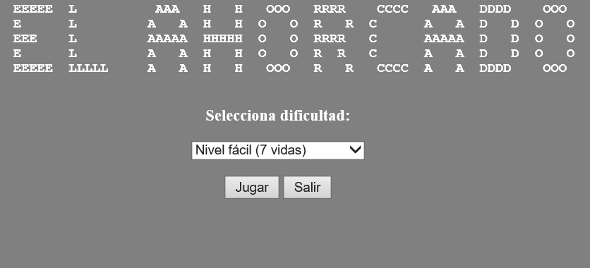
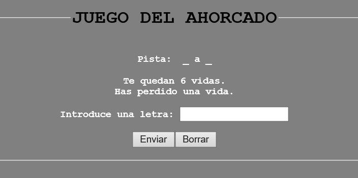
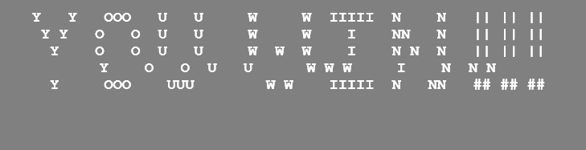
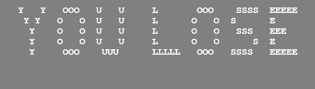

# T4.2.2 · Juego del ahorcado

| Módulo | Unidad | Tipo | Restricciones |
|---|---|---|---|
| MP0613 · DWES | UD4 · Formularios | Proyecto | Sin cookies ni sesiones · código organizado en funciones |

---

## Simulación del juego del ahorcado

Implementa el juego del ahorcado. Usaremos una matriz de 2 dimensiones de 50 × 15 que se inicializará **de forma explícita**, para no tener que cargarla en cada ejecución.

El juego tendrá 3 niveles de dificultad. Lo único que cambia en cada nivel es el número de vidas que recibe el usuario al empezar:

| Nivel | Vidas |
|---|---|
| Fácil | 7 |
| Intermedio | 6 |
| Difícil | 5 |

Al empezar el juego se indicará al usuario cuántos caracteres tiene la palabra a adivinar y de cuántas vidas dispone. El propio programa elegirá la palabra al azar entre las 50. El usuario introducirá una letra y, si la letra está en la palabra, se destaparán las posiciones en las que aparece.

Por ejemplo, si la palabra es *manzana* y el usuario introduce la `a`, se mostrará:

```
_a__a_a
```

### Pantallas de referencia

| Inicio | Partida |
|---|---|
|  |  |

| Victoria | Derrota |
|---|---|
|  |  |

### Reglas

- No hace falta llevar la cuenta de las letras que ha introducido el usuario ni mostrárselas.
- Si el usuario introduce la letra A y no está en la palabra, pierde una vida. Si vuelve a introducir la A, vuelve a perder otra vida.
- **No usar cookies ni sesiones** en este ejercicio.
- Organizar el código en **funciones**.
- Si el usuario introduce más de una letra, nos quedamos con la primera.
