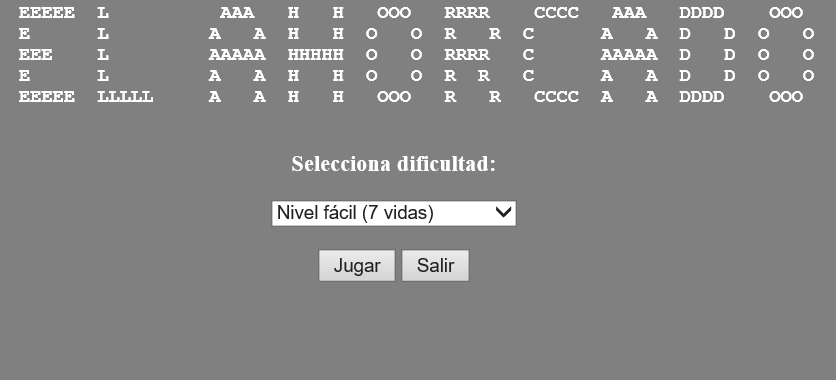
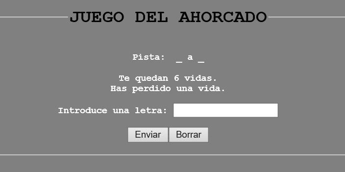
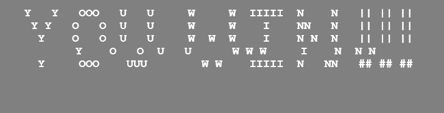
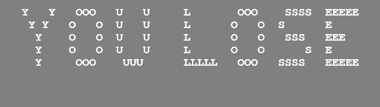

# T4.3.3 · Juego del ahorcado con sesiones

| Módulo | Unidad | Tipo | Plazo |
|---|---|---|---|
| MP0613 · DWES | UD4 · Cookies y sesiones | **Tarea evaluable** (ZIP + vídeo) | Abre: lun 23/11/2026 00:00 · **Vence: jue 10/12/2026 23:59** |

> ⛔ **No se admiten entregas fuera de plazo:** la tarea se cierra y se bloquea la entrega.

Esta tarea amplía y mejora la [T4.2.2 · Juego del ahorcado](../T4.2.2-Ahorcado/).

---

## Simulación del juego del ahorcado

> **NO SE PUEDEN USAR CAMPOS `hidden`.**

Implementa el juego del ahorcado. Usaremos una matriz de 50 palabras para inicializar el juego.

El juego tendrá 3 niveles de dificultad. Lo único que cambia en cada nivel es el número de vidas que recibe el usuario al empezar:

| Nivel | Vidas |
|---|---|
| Fácil | 7 |
| Intermedio | 6 |
| Difícil | 5 |

Al empezar el juego se indicará al usuario cuántos caracteres tiene la palabra a adivinar y de cuántas vidas dispone. El propio programa elegirá la palabra al azar entre las 50. El usuario introducirá una letra y, si la letra está en la palabra, se destaparán las posiciones en las que aparece.

Por ejemplo, si la palabra es *manzana* y el usuario introduce la `a`, se mostrará:

```
_a__a_a
```

### Pantallas de referencia

| Inicio | Partida |
|---|---|
|  |  |

| Victoria | Derrota |
|---|---|
|  |  |

### Reglas

- Si el usuario pulsa el botón **Salir**, se mostrará una pantalla de despedida.
- No hace falta llevar la cuenta de las letras que ha introducido el usuario ni mostrárselas.
- Si el usuario introduce la letra A y no está en la palabra, pierde una vida. Si vuelve a introducir la A, vuelve a perder otra vida.
- No utilizar Sesiones en este ejercicio. *(Ver la nota de abajo.)*
- Organizar el código en **funciones**.
- Si el usuario introduce más de una letra, nos quedamos con la primera.
- Da igual que la letra se introduzca en mayúsculas o en minúsculas: si la letra está en la palabra, se considera válida.
- Las vocales con tilde no se cuentan como fallo, tanto si el usuario introduce una vocal con tilde como si la palabra tenía una vocal con tilde.

> ⚠️ **Nota:** el PDF dice «No utilizar Sesiones», pero el título de la tarea (*Sesiones*) y la prohibición de campos `hidden` indican que el estado de la partida **debe guardarse en la sesión**. Parece una línea copiada de la T4.2.2 («No utilizar Cookies ni Sesiones»). Confírmalo con el profesor antes de entregar.

### Ampliación: cookie de usuario

Una vez resuelto lo anterior, añade lo siguiente:

- En la página inicial, añade un campo **nombre** encima del selector de nivel para recoger el nombre del usuario.
- El nombre y el nivel de dificultad se guardarán en una **cookie que dure una semana**.
- Si el usuario entra en la página del juego y la cookie existe, verá el mensaje de saludo **«Bienvenido de nuevo XXX»** y el nivel de dificultad aparecerá preseleccionado.

---

## Entrega

Además del código en PHP, hay que grabar un **vídeo demostrativo corto** con este contenido:

1. **Ejecución y demostración** del uso de la aplicación:
   - Jugar una palabra hasta ganar.
   - Jugar una palabra hasta perder.
   - La segunda vez que se entra en la aplicación, demostrar y explicar cómo funciona la cookie que ha guardado el nombre y el nivel de dificultad.
2. **Explicación de dos fragmentos de código** que te parezcan relevantes o que te hayan costado más.

### ¿Qué hay que entregar?

- 📦 Un **fichero `.zip`** con el código de la aplicación.
- 🎬 Un **fichero `.mp4`** con el vídeo explicativo, o un enlace para descargarlo si pesa demasiado para subirlo a la plataforma.
